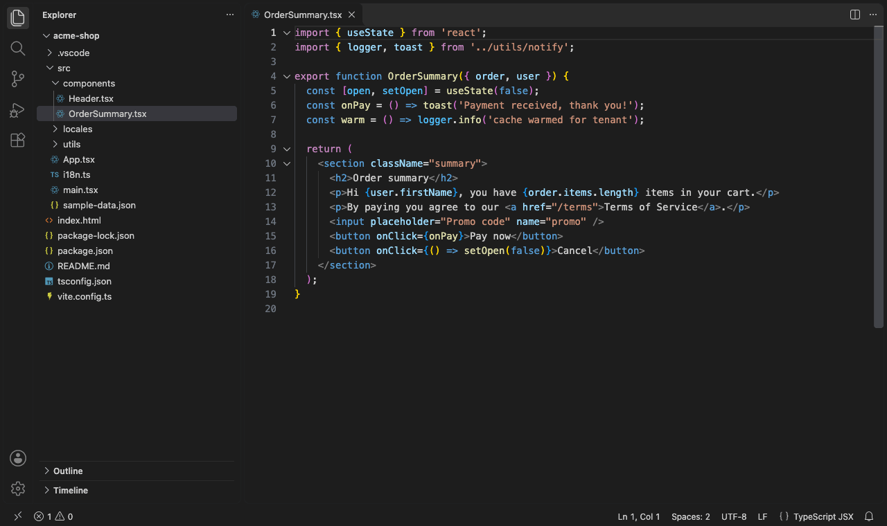
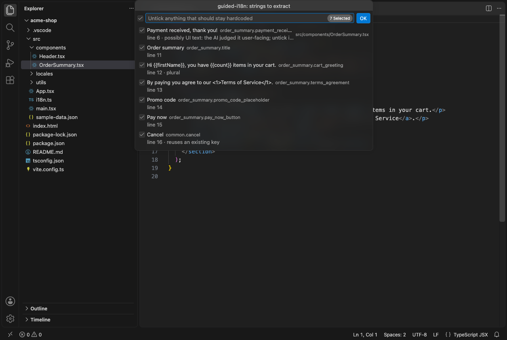
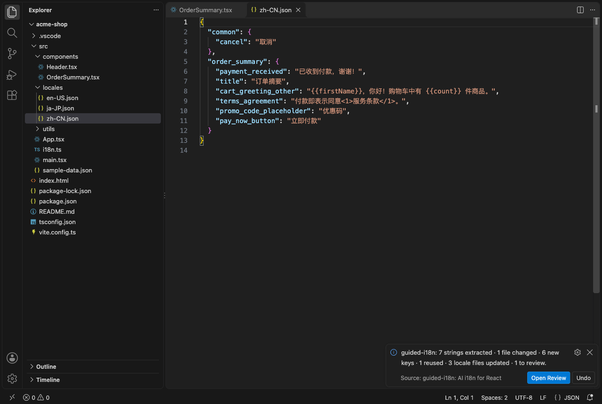

# guided-i18n

**Internationalize your React app in a few clicks: no prompts, no surprises.**

A VS Code extension that finds the hardcoded text in a React app, moves it into
**react-i18next** with sensible keys, and translates it with the AI provider you
choose. You review every string and key before anything changes.

**Install:**
[VS Code Marketplace](https://marketplace.visualstudio.com/items?itemName=BosiTerryLin.guided-i18n) ·
[Open VSX](https://open-vsx.org/extension/BosiTerryLin/guided-i18n) (Cursor, Windsurf, VSCodium)

## Why it's different

- **You approve every change.** One checklist shows every string and the key it
  will get. **Preview First** shows the full diff, **Rename Keys…** fixes a key
  before applying, and **Undo** reverts the whole run, code and language files
  together.
- **Your code stays on your machine.** A parser finds the strings locally. Only
  the strings and short context labels (file, component, tag) go to the AI,
  never whole files.
- **The standard result.** Plain react-i18next with JSON language files, in the
  languages you pick. No custom runtime, nothing to lock you in.
- **The hard parts handled:** every plural form each language needs (Russian
  four, Arabic six), markup inside sentences as `<Trans>`, placeholders checked
  in every translation, and the same word in different places ("Close" a
  dialog vs. "Close" an account) kept apart.

## Cost

The extension is free. You bring your own API key (Anthropic, OpenAI, DeepSeek
or any OpenAI-compatible provider) and pay the provider directly. A single file
usually costs cents; in our tests a project of about 840 files cost a few
dollars.

## Getting started

1. Install the extension and open your React project.
2. Run **guided-i18n: Set Up i18next** (skip this if you already use
   react-i18next).
3. Run **guided-i18n: Choose Target Languages**.
4. Open a component and run **guided-i18n: Scan & Refactor**.

The full guide, commands and settings are on the
[Marketplace page](https://marketplace.visualstudio.com/items?itemName=BosiTerryLin.guided-i18n).

## More

- **The story behind it:**
  [Wrapping strings in t() was the easy part of translating my React app](https://dev.to/lb0ss/wrapping-strings-in-t-was-the-easy-part-of-translating-my-react-app-28lf)
- **Bugs and ideas:** [Issues](https://github.com/lb0ss/guided-i18n/issues)
- **Changes:** see the Changelog tab on the Marketplace page

This repository holds the extension's public images and issue tracker. The
source code is not public; the extension is free to use.
